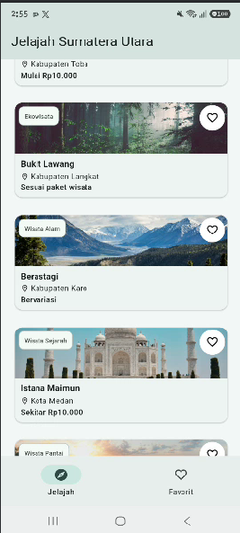
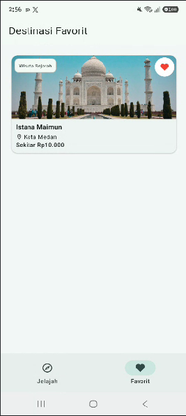
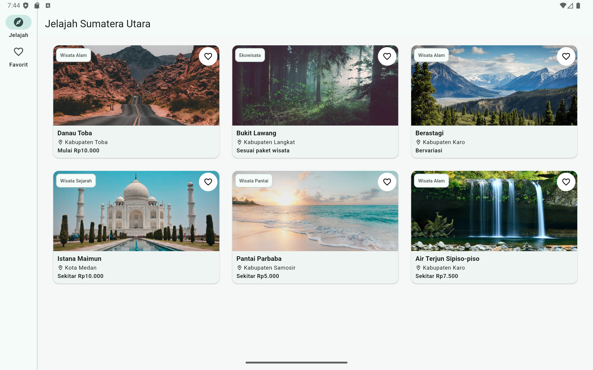
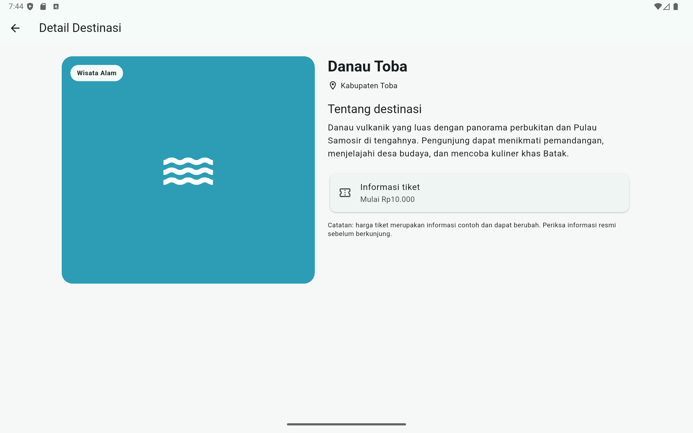

# Jelajah Sumatera Utara

## Identitas
- **Nama:** Yusrida Jelianti Sihite
- **NIM:** 4243250048
- **Kelas:** PSIK 24C
- **Mata Kuliah:** Pemrograman Mobile
- **Tugas:** Tugas Rutin 6 – Aplikasi Wisata Sumatera Utara (Responsif & Multi-Screen)

## Deskripsi
Jelajah Sumatera Utara adalah aplikasi panduan wisata yang menampilkan enam destinasi: Danau Toba, Bukit Lawang, Berastagi, Istana Maimun, Pantai Parbaba, dan Air Terjun Sipiso-piso. Aplikasi memiliki halaman daftar, halaman detail, navigasi Jelajah dan Favorit, serta penanganan ID destinasi yang tidak ditemukan.

## Teknologi dan fitur
- Flutter dan Material 3.
- `LayoutBuilder` untuk menentukan jumlah kolom grid.
- `Row`, `Column`, `Expanded`, dan `Stack` untuk menyusun konten.
- `MediaQuery` dapat digunakan untuk membaca ukuran layar global bila dibutuhkan; pada implementasi ini keputusan breakpoint lokal menggunakan `LayoutBuilder` agar mengikuti ruang yang tersedia pada widget.
- `go_router` dengan path parameter `/destinasi/:id`.
- `NavigationBar` pada lebar di bawah 840 dp dan `NavigationRail` mulai 840 dp.

## Screenshot
Simpan screenshot hasil aplikasi pada folder `screenshots/` dengan nama berikut:flutter run -v

### Ponsel – halaman daftar


### Ponsel – halaman favorit


### Tablet – halaman daftar


### Tablet – halaman detail


## Keputusan desain responsif (150–200 kata)
Aplikasi menggunakan beberapa breakpoint berdasarkan lebar ruang yang tersedia. Pada halaman daftar, `LayoutBuilder` menentukan jumlah kolom grid: satu kolom untuk lebar di bawah 600 dp, dua kolom untuk 600–839 dp, dan tiga kolom mulai 840 dp. Batas ini dipilih agar kartu tetap memiliki ruang yang cukup untuk menampilkan nama, lokasi, kategori, dan harga tanpa membuat teks terlalu sempit. Pada navigasi utama, lebar di bawah 840 dp menggunakan `NavigationBar` di bagian bawah, sedangkan lebar 840 dp atau lebih menggunakan `NavigationRail` di sisi kiri agar ruang horizontal tablet dan layar lebar dimanfaatkan. Halaman detail memakai susunan vertikal pada lebar di bawah 700 dp dan susunan berdampingan menggunakan `Row` serta `Expanded` pada lebar 700 dp atau lebih. `LayoutBuilder` dipilih karena keputusan layout bergantung pada constraints yang diterima masing-masing bagian, bukan hanya ukuran layar secara keseluruhan. `MediaQuery` tidak dipakai untuk breakpoint utama karena kebutuhan tersebut bersifat lokal. `Stack` menempatkan label kategori di atas ilustrasi destinasi, sedangkan `Expanded`, batas baris, dan ellipsis membantu mencegah overflow.

## Pengujian
Jalankan perintah berikut:
```bash
flutter pub get
dart format lib test
flutter analyze
flutter test
flutter run
```

## Pernyataan penggunaan AI
AI digunakan sebagai alat bantu untuk menyusun kerangka awal kode, memahami penggunaan widget responsif, dan membantu penyusunan dokumentasi. Implementasi akhir, penyesuaian, pengujian, serta verifikasi hasil dilakukan kembali oleh mahasiswa.

## Catatan
Data harga tiket pada aplikasi merupakan data contoh untuk kebutuhan tugas. Periksa sumber resmi destinasi untuk informasi harga dan operasional terbaru.
